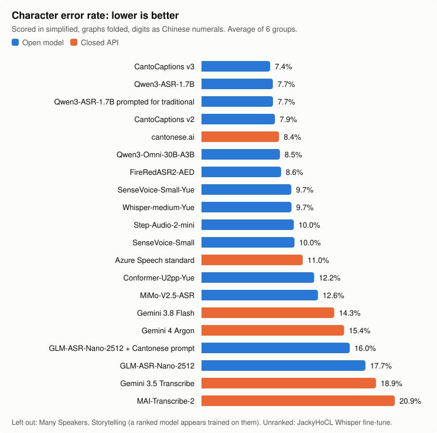

# cantonese-asr-evals-open-and-closed

Which speech-to-text model is best for Cantonese? We ran open and paid models on the same 2,283 clips and scored them by
character error rate.

**Built on the work of others:**

- **[hon9kon9ize's Cantonese ASR evals](https://github.com/hon9kon9ize/cantonese_asr_eval)**, continuing
  [AlienKevin's](https://github.com/AlienKevin/cantonese_asr_eval), inspired this round. We use their scoring method and
  all our test sets except CantoMap and LIDA.
- **[CantoCaptions](https://cantocaptions.com)** and **[rookes](https://github.com/rookes)** made two of the models tested
  here, the graph-folding rules behind our scoring, and the Hong Kong converter table.

[Other credits](#acknowledgements) are at the bottom.

## Best model by task

- **Best overall: [CantoCaptions v3](https://huggingface.co/rookes/cantocaptions-cantonese-asr)**, from the
  [CantoCaptions](https://cantocaptions.com) project ([code](https://github.com/rookes/cantocaptions-ai)), with
  Qwen3-ASR-1.7B close behind (the gap is within noise). CantoCaptions writes traditional out of the box; Qwen often writes
  simplified and needs a Hong Kong converter (`cantoeval/convert.py`).
- **Best paid API:** cantonese.ai, then Azure Speech standard (`zh-HK`), though the top open models beat both.
- **General models given a transcription prompt (Gemini 4 Argon, Gemini 3.8 Flash)** get English words inside Cantonese
  right most often of the ranked models (89% of English words, against 84% for CantoCaptions v3, which often writes a
  Chinese sound-alike: alfresco → 阿弗雷克); CER barely shows this. But they do badly on very short clips, with no
  sentence around them (Argon: 38% under 2 seconds), and sometimes tidy up conversational speech (唔係唔係 → 咪).
  Knowing 《三國演義》's names helps them on Storytelling.
- **Bigger audio models don't win.** Qwen3-Omni (30B, 3B active) comes close to Qwen3-ASR-1.7B; Step-Audio-2-mini (8.3B)
  and MiMo-V2.5-ASR (8B) trail it, mostly on very short clips (MiMo: 27% CER under 2 seconds, against 11% for
  CantoCaptions v3). FireRedASR2-AED (1.15B) is the best of the models not built on Qwen.
- **The WenetSpeech-Yue models** (SenseVoice-Small-Yue, Whisper-medium-Yue, Conformer-U2pp-Yue) write simplified and put
  English in capitals. In simplified, SenseVoice-Small-Yue and Whisper-medium-Yue (both 9.7%) edge out stock SenseVoice
  (10.0%) and U2pp trails (12.2%); in traditional they have no converter and score 33–36%.

<!-- results:begin -->
| Task | Best | Within a point |
|---|---|---|
| Many Speakers | **Qwen3-ASR-1.7B prompted for traditional** 4.1% | Qwen3-ASR-1.7B 4.4%, Step-Audio-2-mini 4.4% |
| Storytelling | **MiMo-V2.5-ASR** 7.2% | Qwen3-Omni-30B-A3B 7.2%, Qwen3-ASR-1.7B 8.2% |
| Conversation | **Qwen3-ASR-1.7B** 17.0% | Qwen3-ASR-1.7B prompted for traditional 17.2%, FireRedASR2-AED 17.6% |
| Canto + Eng Mixed | **CantoCaptions v2** 7.4% | Gemini 4 Argon 7.5%, CantoCaptions v3 7.7% |
| Synthetic Voice | **Qwen3-ASR-1.7B** 6.4% | CantoCaptions v3 6.5%, CantoCaptions v2 7.3% |
| GZ Daily Use | **CantoCaptions v2** 2.6% | Step-Audio-2-mini 2.7%, Qwen3-Omni-30B-A3B 2.7% |
| GZ Car Commands | **cantonese.ai** 4.1% | Qwen3-ASR-1.7B prompted for traditional 4.5%, Qwen3-ASR-1.7B 4.7% |
| Stories by Level | **CantoCaptions v3** 3.2% | – |

Scored in simplified. The winners are the same models in traditional, where Qwen needs a converter; the GZ tasks have no traditional references. A model flagged on a task isn't listed for it.

## Overall



### Simplified

| Model | Type | Size | Average | Many Speakers (300) † | Storytelling (300) † | Conversation (300) | Canto + Eng Mixed (300) | Synthetic Voice (300) | GZ Daily Use (300) | GZ Car Commands (300) | Stories by Level (183) |
|---|---|---|---|---|---|---|---|---|---|---|---|
| CantoCaptions v3 | open | 1.7B | **7.4%** | 4.5% | 8.5% | 18.9% | 7.7% | 6.5% | 2.9% | 5.3% | 3.2% |
| Qwen3-ASR-1.7B | open | 1.7B | **7.7%** | 4.4% | 8.2% | 17.0% | 10.2% | 6.4% | 2.7% | 4.7% | 5.2% |
| Qwen3-ASR-1.7B prompted for traditional | open | 1.7B | **7.7%** | 4.1% | 8.6% | 17.2% | 9.0% | 7.3% | 2.8% | 4.5% | 5.5% |
| CantoCaptions v2 | open | 1.7B | **7.9%** | 4.5% | 8.7% | 20.4% | 7.4% | 7.3% | 2.6% | 5.6% | 4.3% |
| cantonese.ai | closed | – | **8.4%** | 1.5% ⚠️ | 4.3% ⚠️ | 17.9% | 10.1% | 10.5% | 3.4% | 4.1% | 4.3% |
| Qwen3-Omni-30B-A3B | open | 30B (3B active) | **8.5%** | 4.6% | 7.2% | 19.2% | 11.0% | 7.5% | 2.7% | 5.3% | 5.1% |
| FireRedASR2-AED | open | 1.15B | **8.6%** | 5.8% | 9.7% | 17.6% | 11.2% | 8.2% | 2.7% | 5.9% | 6.1% |
| SenseVoice-Small-Yue | open | 234M | **9.7%** | 6.5% | 10.2% | 20.1% | 15.0% | 8.0% | 3.0% | 5.3% | 6.8% |
| Whisper-medium-Yue | open | 769M | **9.7%** | 6.5% | 9.5% | 20.3% | 13.1% | 8.2% | 3.7% | 7.9% | 5.0% |
| Step-Audio-2-mini | open | 8.3B | **10.0%** | 4.4% | 10.2% | 19.7% | 13.9% | 12.2% | 2.7% | 5.0% | 6.4% |
| SenseVoice-Small | open | 234M | **10.0%** | 6.5% | 11.2% | 20.2% | 15.8% | 8.6% | 3.4% | 5.1% | 7.1% |
| Azure Speech standard | closed | – | **11.0%** | 7.4% | 16.0% | 19.4% | 15.4% | 10.5% | 4.5% | 10.5% | 5.4% |
| Conformer-U2pp-Yue | open | 130M | **12.2%** | 8.2% | 10.5% | 21.6% | 23.9% | 9.1% | 4.6% | 7.0% | 6.7% |
| MiMo-V2.5-ASR | open | 8B | **12.6%** | 7.6% | 7.2% | 24.7% | 13.3% | 13.2% | 5.1% | 8.6% | 10.6% |
| Gemini 3.8 Flash | closed | – | **14.3%** | 11.2% | 11.8% | 31.7% | 9.1% | 12.5% | 9.3% | 13.3% | 10.3% |
| Gemini 4 Argon | closed | – | **15.4%** | 5.2% | 11.9% | 30.9% | 7.5% | 17.7% | 7.3% | 14.8% | 14.2% |
| GLM-ASR-Nano-2512 + Cantonese prompt | open | 1.5B | **16.0%** | 12.0% | 19.4% | 25.2% | 17.0% | 21.7% | 7.1% | 13.3% | 11.9% |
| GLM-ASR-Nano-2512 | open | 1.5B | **17.7%** | 13.8% | 19.8% | 29.3% | 16.2% | 25.4% | 7.8% | 14.8% | 12.9% |
| Gemini 3.5 Transcribe | closed | – | **18.9%** | 15.3% | 24.6% | 30.1% | 14.8% | 19.0% | 15.9% | 20.0% | 13.5% |
| MAI-Transcribe-2 | closed | – | **20.9%** | 12.3% | 28.8% | 22.1% | 14.0% | 26.9% | 17.9% | 17.9% | 26.5% |
| JackyHoCL Whisper fine-tune | open | 809M | unranked | 0.9% ⚠️ | 19.0% | 26.1% | 2.1% ⚠️ | 13.5% | 5.5% | 10.5% | 9.1% |

### Traditional

| Model | Type | Size | Average | Many Speakers (300) † | Storytelling (299) † | Conversation (300) | Canto + Eng Mixed (243) | Synthetic Voice (300) | Stories by Level (182) |
|---|---|---|---|---|---|---|---|---|---|
| CantoCaptions v3 | open | 1.7B | **9.1%** | 4.7% | 8.7% | 19.0% | 7.4% | 6.7% | 3.2% |
| Qwen3-ASR-1.7B prompted for traditional + HK converter | open | 1.7B | **9.8%** | 4.5% | 9.0% | 17.4% | 8.7% | 7.4% | 5.7% |
| Qwen3-ASR-1.7B + HK converter | open | 1.7B | **9.8%** | 4.8% | 8.6% | 17.2% | 10.1% | 6.5% | 5.5% |
| CantoCaptions v2 | open | 1.7B | **9.9%** | 4.7% | 8.9% | 20.6% | 7.4% | 7.2% | 4.4% |
| cantonese.ai | closed | – | **10.6%** | 1.6% ⚠️ | 4.6% ⚠️ | 18.1% | 9.4% | 10.6% | 4.4% |
| Qwen3-Omni-30B-A3B | open | 30B (3B active) | **11.9%** | 4.9% | 8.6% | 23.6% | 10.3% | 7.8% | 5.8% |
| SenseVoice-Small + HK converter | open | 234M | **12.9%** | 6.9% | 11.5% | 20.4% | 15.4% | 8.7% | 7.4% |
| Azure Speech standard | closed | – | **13.5%** | 7.7% | 16.6% | 22.7% | 15.0% | 10.5% | 5.8% |
| Gemini 3.8 Flash | closed | – | **15.8%** | 11.2% | 11.9% | 31.7% | 8.9% | 12.4% | 10.2% |
| Gemini 4 Argon | closed | – | **17.7%** | 5.3% | 12.1% | 31.1% | 7.6% | 17.9% | 14.2% |
| Gemini 3.5 Transcribe | closed | – | **19.2%** | 15.6% | 24.9% | 30.3% | 13.8% | 19.1% | 13.6% |
| GLM-ASR-Nano-2512 + Cantonese prompt | open | 1.5B | **20.1%** | 13.4% | 21.0% | 28.5% | 16.9% | 22.0% | 13.1% |
| MAI-Transcribe-2 | closed | – | **22.6%** | 12.9% | 29.7% | 22.2% | 13.8% | 27.6% | 26.7% |
| GLM-ASR-Nano-2512 | open | 1.5B | **22.7%** | 15.1% | 22.1% | 33.1% | 15.8% | 27.0% | 14.8% |
| FireRedASR2-AED | open | 1.15B | **32.6%** | 30.8% | 35.2% | 42.1% | 23.2% | 34.8% | 30.5% |
| Whisper-medium-Yue | open | 769M | **33.1%** | 31.8% | 35.2% | 44.6% | 24.5% | 34.0% | 29.4% |
| SenseVoice-Small-Yue | open | 234M | **33.9%** | 31.7% | 35.5% | 44.5% | 26.2% | 34.3% | 30.6% |
| Step-Audio-2-mini | open | 8.3B | **34.6%** | 30.4% | 36.0% | 44.8% | 25.2% | 37.8% | 30.5% |
| Conformer-U2pp-Yue | open | 130M | **36.1%** | 32.9% | 35.7% | 45.2% | 34.1% | 34.5% | 30.7% |
| MiMo-V2.5-ASR | open | 8B | **36.5%** | 33.1% | 33.4% | 48.3% | 24.4% | 38.9% | 34.5% |
| JackyHoCL Whisper fine-tune | open | 809M | unranked | 0.9% ⚠️ | 19.8% | 26.2% | 2.0% ⚠️ | 14.6% | 9.4% |

Percentages are character error rates, graphs folded, digits → 中文. ⚠️ very likely trained on this test data. † left out of every Average. All eight scoring combinations and every transcript are in [`results/`](results/summary.md) (run `20261108T044145Z`).
<!-- results:end -->

**How to read this**

- A gap of a point or two is noise.
- **Average** is the plain mean of the groups no ranked model appears trained on, so ranked models share the same data.
  Groups marked † are left out, for all of them.
- **Simplified comes first, as in the community evals:** everything is converted to simplified, so a model's script doesn't
  count. Traditional scores what Hong Kong readers see, but has no Guangzhou groups, where Qwen is strong. The two aren't
  comparable, so only compare within a table.
- **Graphs folded** counts interchangeable spellings as equal (啦/喇/嘞). **Digits → 中文** counts 2016 and 二零一六 as equal.
  Letter case never counts (HELP = help).
- **Size** is the parameter count; for a mixture-of-experts model, also how many are active per token.
- **Scoring changes the details, not the picture.** Across all eight combinations, CantoCaptions v3 and Qwen stay in the
  top four, cantonese.ai is the best paid API, and Azure is next.
- **⚠️ marks scores that can't be compared,** because the model very likely trained on that data, which is common with
  public datasets. cantonese.ai is ranked on the rest. The JackyHoCL Whisper fine-tune is unranked: its model card lists
  Common Voice and the Canto + Eng Mixed data as training data, and we have no stock Whisper beside it. Unlike a ranked model's
  flags, its flags don't remove a group from the average, which also keeps CantoCaptions' strong Canto + Eng Mixed result in.
- Conversation's references are rough, so judge that column by big gaps only.

More detail is in [`docs/details.md`](docs/details.md).

## Run it

You need Python 3.12, [uv](https://docs.astral.sh/uv/) and `ffmpeg`.

```
uv sync
uv run python -m cantoeval ui                        # browse the results and diffs; needs no audio (first load ~30 s)
uv run python -m cantoeval check                     # verify the clips and scoring
uv run python -m cantoeval run --models sensevoice   # transcribe and score
```

The WenetSpeech-Yue checkpoints need `uv run python scripts/fetch_models.py` first. MiMo-V2.5-ASR, Step-Audio-2-mini and
Qwen3-Omni run on [Modal](https://modal.com) GPUs: `uv run --with modal python scripts/modal_batch.py mimo-asr` (about
$1–2 a model for the full set; see [`docs/details.md`](docs/details.md#running)).

Transcribing needs the clips (below). Hosted models need keys: `cp .env.example .env`, then fill in what you run.

| Model | `.env` entries |
|---|---|
| `gemini`, `gemini-3.8-flash`, `gemini-argon` | `GEMINI_API` (paid) or `GEMINI_API_FREE_KEY` (free tier) |
| `azure-standard`, `mai` | `MAI_ENDPOINT` (`https://<resource>.cognitiveservices.azure.com`), `MAI_API_KEY` |
| `cantonese-ai` | `CANTONESE_AI_API_KEY` |

## Test data

| Task | Source | Clips | License | What it tests |
|---|---|---|---|---|
| Many Speakers (their Mixed) | [Mozilla Common Voice](https://commonvoice.mozilla.org) 17.0 `yue` test split, via [this mirror](https://huggingface.co/datasets/fsicoli/common_voice_17_0) | 300 | CC0 | Many speakers reading short prompts |
| Storytelling | 張悦楷 reading 《三國演義》, [hon9kon9ize's set](https://huggingface.co/datasets/hon9kon9ize/zoengjyutgaai_saamgwokjinji) | 300 | CC0 | One storyteller, literary text |
| Conversation | CantoMap, [Winterstein, Tang & Lai (2020)](https://github.com/gwinterstein/CantoMap), test split, via [safecantonese](https://huggingface.co/datasets/safecantonese/cantomap) | 300 | GPL-3.0 | Two people talking: spontaneous speech, fillers, some English |
| Canto + Eng Mixed (their Yue & Eng) | [Whisper_MCE](https://github.com/Shelton1013/Whisper_MCE), via [AlienKevin](https://huggingface.co/datasets/AlienKevin/mixed_cantonese_and_english_speech) | 300 | None stated | English words inside Cantonese sentences |
| Synthetic Voice | [words.hk](https://words.hk) example sentences, AWS Polly's Hiujin voice, via [AlienKevin](https://huggingface.co/datasets/AlienKevin/wordshk_cantonese_speech) | 300 | CC BY 4.0 | Hong Kong written Cantonese, wide vocabulary; synthetic speech |
| GZ Daily Use | MagicHub ASR-SCCantDuSC, via [AlienKevin](https://huggingface.co/datasets/AlienKevin/guangzhou-daily-use-speech) | 300 | CC BY-NC-ND 4.0 | Guangzhou accent, mainland spellings (咁/俾/啦) |
| GZ Car Commands | MagicHub ASR-SCCantCabSC, via [AlienKevin](https://huggingface.co/datasets/AlienKevin/guangzhou-cabin-speech) | 300 | CC BY-NC-ND 4.0 | Guangzhou accent in a car: digits, commands, queries |
| Stories by Level | [LIDA Stories Hong Kong](https://lidastories.net) (© LIDA故事香港), read by Stephanie Hung; [our cut](https://huggingface.co/datasets/jdhe1120/cantonese-lida-stories-speech) into pages, text normalised | 183 | CC BY 4.0 | Graded learner material, levels 1-5, one narrator |

Only Common Voice and CantoMap are held-out test splits. The other public sets have no test split, so models may have
trained on them. "Their" names are the community evals' labels. We use the same dataset under a clearer name.

### Getting the clips

```
uv run python scripts/prepare_public.py -n 300 --sets commonvoice narration cantomap mixed wordshk gzdaily gzcabin
uv run python scripts/fetch_lida.py
```

Sampling is seeded, so the same command gives the same clips. `scripts/prepare_stories.py` and
`scripts/prepare_norway.py` are how the LIDA clips were cut from the original mp3 and PDF files (they also need
`pdftotext`, from poppler); `fetch_lida.py` downloads the result.

Why each group behaves as it does, and which clips were excluded, is in [`docs/details.md`](docs/details.md#test-data).

## License

The code is MIT (`LICENSE`). Third-party files in `rules/` keep their own licenses, with each license file beside them.
The reference sentences in `results/` come from the datasets below and stay under those datasets' terms; that includes
CantoMap (GPL-3.0) and the Guangzhou sets (CC BY-NC-ND 4.0).

## Acknowledgements

- **Scoring.** The protocol (OpenCC t2s, strip punctuation and spaces, mean of per-utterance CER) follows the evals above.
- **CantoCaptions.** The models are [rookes/cantocaptions-cantonese-asr](https://huggingface.co/rookes/cantocaptions-cantonese-asr),
  trained on the community [CantoCaptions](https://github.com/notHulK11/CantoCaptions) subtitles.
- **Graph folding.** `rules/bench_conventions.toml` is by Jon Miller ([rookes](https://github.com/rookes)), MIT, used with
  permission. The lines in `cantoeval/normalize.py` that add simplified forms are adapted from the same project.
- **HK converter.** `rules/opencc_hk_cantocaptions.txt` is from [cantocaptions-ai](https://github.com/rookes/cantocaptions-ai)
  (BSD 2-Clause), built on [OpenCC](https://github.com/BYVoid/OpenCC)'s table (Apache-2.0).
- **Data.** Every dataset is credited in [Test data](#test-data).

